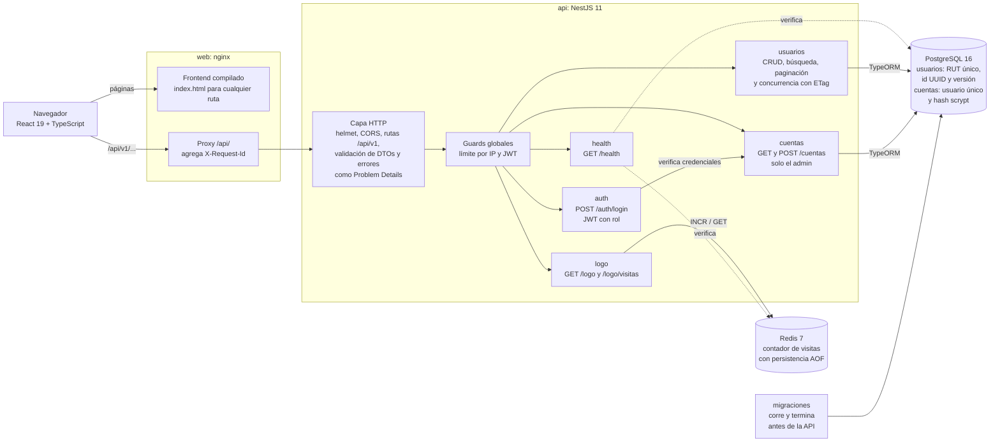
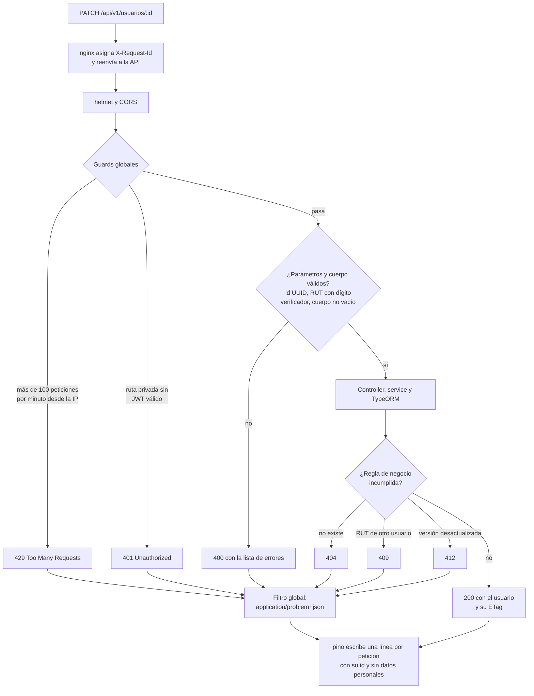
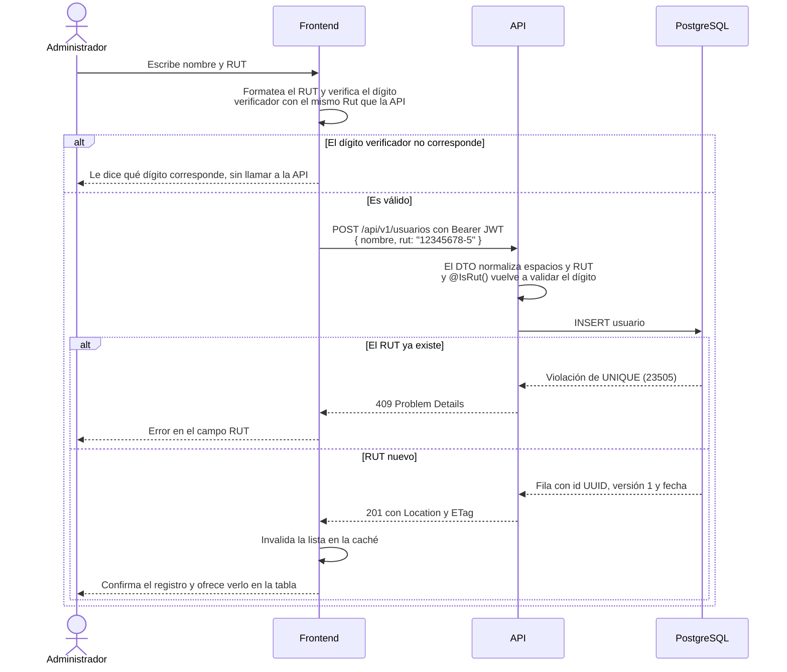
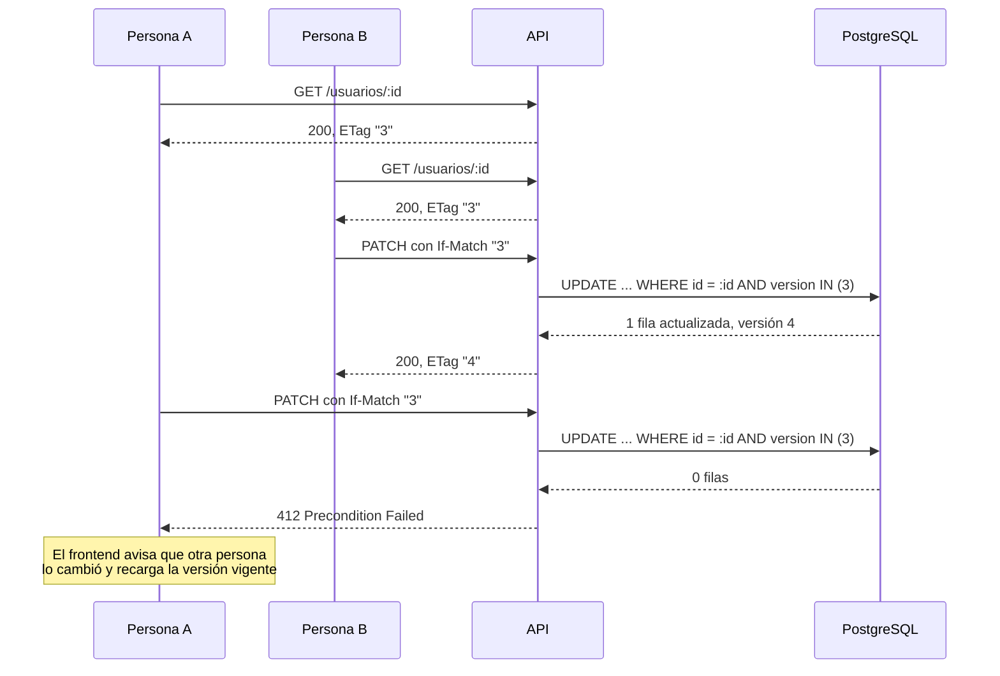
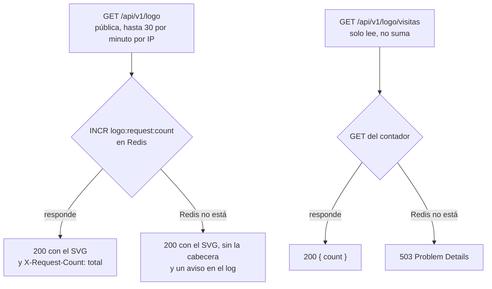

# Registro de usuarios: prueba de modernización

Una API NestJS para registrar personas con su RUT, con un contador de visitas al logo en Redis, y un frontend React que la consume. Este repositorio parte del código de la prueba y lo moderniza de punta a punta.

> **Enunciado de la prueba**
>
> Tareas a realizar por postulantes:
>
> NOTA: La prueba esta diseñada para abordar la creatividad, conocimiento y experiencia de los postulantes, se valora muchísimo la implementación de mejoras del código, el hecho de poder abordar la mayor cantidad de mejoras y buenas prácticas que consideres para nosotros es clave y nos permite conocerte mejor como desarrollador, es una prueba fullstack por lo que se considera el ciclo end-to-end.
>
> Puntos de partida:
> 1. Elaborar diagrama de arquitectura
> 2. Elaborar diagrama de flujo
> 3. ¿Qué mejoras implementarías?

Las respuestas están más abajo: [arquitectura](#1-diagrama-de-arquitectura), [flujos](#2-diagramas-de-flujo) y [mejoras](#3-qué-mejoras-implementarías).

## Cómo levantarlo

Requisitos: Node 26, pnpm y Docker.

```bash
pnpm install
cp .env.example .env
# En .env, completa:
#   JWT_SECRET          → openssl rand -hex 32
#   AUTH_PASSWORD_HASH  → pnpm auth:hash-password <contraseña>
pnpm dev --seed
```

`pnpm dev` levanta Postgres y Redis con Docker, aplica las migraciones, carga usuarios de demostración (`--seed`) y arranca la API y el frontend:

- Frontend: http://localhost:5173 (usuario `admin` y la contraseña que elegiste). Desde **Cuentas**, el admin ve y crea las cuentas de otras personas.
- API: http://localhost:3000/api/v1, documentada con OpenAPI en http://localhost:3000/docs

Con `docker compose up` se levanta el stack de producción: el frontend en http://localhost:8080 servido por nginx, la API, las migraciones, Postgres y Redis.

El frontend tiene sus propias dependencias: `pnpm dev` las instala si faltan, o `pnpm --dir frontend install`.

| Comando | Qué hace |
| --- | --- |
| `pnpm test` | Tests unitarios del backend |
| `pnpm test:e2e` | Tests e2e del backend contra Postgres y Redis desechables (Testcontainers) |
| `pnpm --dir frontend test` | Tests del frontend (Vitest) |
| `pnpm --dir frontend test:e2e` | Tests e2e con navegador real (Playwright) contra el stack completo |

Cada pull request corre todo lo anterior en GitHub Actions ([`.github/workflows/ci.yml`](.github/workflows/ci.yml)), en tres checks: **Backend**, **Frontend** y **E2E**. Los tres son obligatorios: sin ellos en verde, `master` no acepta el merge.

## 1. Diagrama de arquitectura



- **Un solo origen para el navegador.** nginx sirve el frontend y reenvía `/api/` a la API, así no hay CORS de por medio. En desarrollo, Vite cumple el mismo papel (`pnpm dev`).
- **La API es privada por defecto.** Un guard JWT global protege todas las rutas; solo `auth`, `logo` y `health` están marcadas como públicas con `@Public()`.
- **Dos roles.** El administrador es el usuario del `.env`; las cuentas que él crea ingresan como `operador`, que gestiona usuarios pero no ve ni crea cuentas. El rol va dentro del JWT y `/cuentas` lo exige con `SoloAdminGuard` (403 si no es admin).
- **El RUT se valida con el mismo código en ambos lados.** El value object `Rut` vive en el dominio del backend (`src/modules/usuarios/domain`) y el frontend lo importa con el alias `@dominio`. Las reglas de usuario y contraseña de las cuentas se comparten igual, con `@dominio-cuentas`.
- **Redis es una dependencia secundaria.** Si cae, la API sigue registrando usuarios y sirviendo el logo; solo se pierde el conteo, y `/health` responde `degraded` en vez de error.
- **El esquema cambia solo con migraciones**, que corren en su propio contenedor antes de que arranque la API. La API nunca altera tablas al iniciar.

## 2. Diagramas de flujo

### 2.1 Una petición a la API

Todo lo que pasa entre que llega una petición y sale la respuesta, con un `PATCH /api/v1/usuarios/:id` como ejemplo.



Login y logo tienen límites propios más estrictos (10 y 30 peticiones por minuto) y `/health` no tiene límite. Un error inesperado responde 500 sin exponer detalles internos.

### 2.2 Registrar un usuario



### 2.3 Editar sin pisar el cambio de otra persona

Cada usuario tiene una versión que sube con cada cambio. La API la entrega como `ETag` y el frontend la devuelve en `If-Match` al guardar.



La versión se compara dentro del mismo `UPDATE` y no en una lectura previa: de dos cambios simultáneos sobre la misma versión, uno se aplica y el otro recibe 412. Un test e2e lo comprueba con dos `PATCH` en paralelo.

### 2.4 Logo y contador de visitas



El SVG se carga en memoria al iniciar la API, así que servirlo no puede fallar. Ambas rutas responden con `Cache-Control: no-store`, para que un caché intermedio no se trague visitas.

## 3. ¿Qué mejoras implementarías?

El detalle está en [docs/MEJORAS.md](docs/MEJORAS.md): una lista de tareas donde cada mejora dice qué se hizo, por qué y en qué commits, y las pendientes dicen qué se haría y por qué.

Los problemas más graves del código original eran:

- El RUT no validaba el dígito verificador ni era único: se podían guardar RUT inexistentes y duplicados, y un duplicado respondía 500.
- La API no tenía autenticación: cualquiera podía listar o borrar usuarios, y el RUT es un dato personal. Además, CORS aceptaba cualquier origen.
- `synchronize` de TypeORM quedaba activo si faltaba `NODE_ENV`, y en producción podía alterar el esquema y perder datos.
- El logo podía botar el servidor: se leía de una ruta relativa al directorio de trabajo, sin manejar el error del stream.
- Si Redis caía, tampoco se entregaba el logo.

## Estructura

```
src/                     API NestJS
├── config/              variables de entorno validadas, CORS, Swagger
├── common/              filtro Problem Details, ETag, pipes y decoradores
├── infrastructure/      base de datos (migraciones, seed), Redis y logs
├── health/              GET /health
└── modules/
    ├── auth/            login con JWT, guard global y roles
    ├── cuentas/         cuentas de operador que crea el admin
    ├── usuarios/        dominio (Rut), entidad, DTOs, controller y service
    └── logo/            logo y contador de visitas
test/                    tests e2e del backend
.github/workflows/       CI: lint, tipos y tests en cada pull request
frontend/                SPA en React (ver frontend/README.md)
docs/MEJORAS.md          mejoras hechas y pendientes
```
